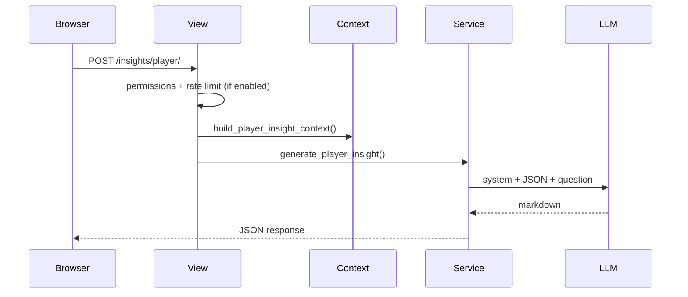

# LeaderLodge AI Insights: Integration Bible

> **Status:** Phase 0 complete; Phase 1 in progress.  
> **Last updated:** 2026-06-23  
> **Companion:** [architecture.md](./architecture.md) (app layout and ranking design only; not a substitute for this doc)

---

## Table of contents

1. [Vision](#1-vision)
2. [What is an LLM, and where does it fit?](#2-what-is-an-llm-and-where-does-it-fit)
3. [Design principles](#3-design-principles)
4. [Product roadmap](#4-product-roadmap)
5. [Supported models](#5-supported-models)
6. [System architecture](#6-system-architecture)
7. [Context building](#7-context-building)
8. [Prompts and guardrails](#8-prompts-and-guardrails)
9. [API contract](#9-api-contract)
10. [UX specification](#10-ux-specification)
11. [Security and privacy](#11-security-and-privacy)
12. [Rate limits, Redis, and when to enable them](#12-rate-limits-redis-and-when-to-enable-them)
13. [Environment variables](#13-environment-variables)
14. [Testing strategy](#14-testing-strategy)
15. [Phase 3 preview: Ask the Lodge](#15-phase-3-preview-ask-the-lodge)
16. [Portfolio showcase](#16-portfolio-showcase)
17. [Implementation checklist](#17-implementation-checklist)
18. [Decision log](#18-decision-log)
19. [References](#19-references)

---

## 1. Vision

LeaderLodge **computes** rankings in Python. AI **interprets** them in plain language.

**Tagline:** *Computed by LeaderLodge. Explained by AI.*

**Non-goals for MVP:** open chat, LLM-computed stats, local model hosting (Ollama), user-supplied API keys.

---

## 2. What is an LLM, and where does it fit?

An **LLM** (Large Language Model) is a cloud API that takes text in and returns text out. You send:

| Part | Content |
|------|---------|
| **System prompt** | Fixed rules: tone, format, "only use provided JSON" |
| **User message** | Structured stats JSON + question |

The model **narrates**; LeaderLodge **measures**. Never let the LLM calculate `rank_score` or query the DB directly (Phase 3 uses validated tools instead).

```text
Game DB to get_player_rank_detail() to context JSON to LLM API to markdown insight
```

**Tokens:** billed in ~4-character chunks. Target ~1,500 input + 400 output per insight; under **$0.001** on cheap models.

---

## 3. Design principles

1. Rankings stay in Python.
2. Ground every answer in a schema-controlled context JSON.
3. Same permissions as the page (group visibility).
4. API keys server-side only.
5. User picks from 3 curated cheap models.
6. Rate limits **implemented but off by default** until needed (see section 12).
7. Version prompts (`PROMPT_VERSION`); bump when instructions change.

---

## 4. Product roadmap

| Phase | Feature | Entry point |
|-------|---------|-------------|
| **1 (MVP)** | Player Insights | Rank detail, Insights button |
| **2** | Group / Hall of Fame trends | Leaderboard, Hall of Fame |
| **3** | Ask the Lodge | NL queries via tool calling |

### Phase 1 presets

| Id | Label |
|----|-------|
| `strengths` | Strengths |
| `weaknesses` | Struggles |
| `superpower` | Best thing about this player |
| `custom` | User question (max ~500 chars) |

---

## 5. Supported models

Owner pays. Users pick among **three** low-cost cloud models:

| Slug | Label | Provider | API model |
|------|-------|----------|-----------|
| `flash-lite` | Gemini Flash-Lite | Google | `gemini-2.5-flash-lite` |
| `gpt-4o-mini` | GPT-4o mini | OpenAI | `gpt-4o-mini` |
| `gemini-flash` | Gemini Flash | Google | `gemini-2.5-flash` |

Default: `flash-lite`. User preference: `UserProfile.ui_settings['insights']['model_id']`.

Registry: `leaderlodge/insights/registry.py`.

---

## 6. System architecture

### App layout

```
leaderlodge/insights/
  registry.py          # model slugs (done)
  limits_defaults.py   # default caps (done)
  limits.py            # merge defaults, settings, user (done)
  rate_limit.py        # cache counters (done; gated by flag)
  context/player.py    # Phase 1: build JSON
  prompts.py           # system + preset templates
  providers/           # OpenAI, Google HTTP clients
  router.py            # slug to provider.complete()
  service.py           # generate_player_insight()
  views.py + urls.py   # POST /insights/player/
```

### Request flow (Phase 1)



---

## 7. Context building

**Function:** `build_player_insight_context(group, player, game_type_code, period)`

**Sources:**

- `get_player_rank_detail()`
- `get_player_rankings()` (leader comparison only)
- Period label from leaderboard period helpers

**Omit from v1:** raw game rows, other players' full stats, PII beyond display names.

**Schema version:** `schema_version: 1` in JSON (see prior bible draft for full field list).

---

## 8. Prompts and guardrails

- System prompt: analyst role, JSON-only facts, sparse-data handling, markdown output cap.
- `PROMPT_VERSION = 1` in `prompts.py`.
- Custom questions: length cap, strip control chars.
- Disclaimer in UI: *AI summary. Rankings computed by LeaderLodge.*

---

## 9. API contract

```
POST /insights/player/
```

Body: `group_id`, `player_id`, `game_type_code`, `year`, `month`, `preset`, `question`, `model`.

Response: `{ "markdown": "...", "meta": { "model", "cached", "prompt_version", ... } }`.

Errors: 403 permission, 429 rate limit (when enabled), 502 provider error.

---

## 10. UX specification

**Phase 1:** Bootstrap offcanvas on rank detail.

Contents: title, model `<select>`, preset chips, custom input, disclaimer, markdown result, Copy / Regenerate.

No navbar item until Phase 3.

---

## 11. Security and privacy

- Keys in env only: `OPENAI_API_KEY`, `GOOGLE_AI_API_KEY`.
- `INSIGHTS_ENABLED=false` hides feature until ready.
- Player display names and aggregates sent to third-party APIs; note in privacy FAQ later.

---

## 12. Rate limits, Redis, and when to enable them

### What we built

Rate limit **code is done** (`limits.py`, `rate_limit.py`, 15 tests). It is **not enforced by default**.

```bash
INSIGHTS_RATE_LIMITS_ENABLED=false   # MVP default
```

When `false`, `check_insight_rate_limit()` and `record_insight_usage()` are no-ops. Phase 1 views should still call them; flipping one env var enables limits later.

### Can you postpone until you see abuse?

**Yes. Recommended for MVP.**

| Concern | MVP approach |
|---------|----------------|
| Rate limiting | **Off** (`INSIGHTS_RATE_LIMITS_ENABLED=false`) |
| Redis | **Not needed** while limits are off |
| Cost control | Cheap models + `INSIGHTS_ENABLED` kill switch; monitor provider dashboards |
| Abuse | Small private groups, low risk; enable limits when you open to strangers or see spikes |

**When to turn limits on:** unexpected API bills, demo mode spam, or public launch.

```bash
INSIGHTS_RATE_LIMITS_ENABLED=true
```

### Redis: do you need it for MVP?

**No**, if rate limits stay disabled.

**When limits are enabled:**

| Deployment | Cache backend | Limit behavior |
|------------|---------------|----------------|
| Local dev / `runserver` | Django LocMem (default) | Works; single process |
| Railway **one worker** | LocMem | Works; single process |
| Railway **multiple workers** | LocMem per worker | Limits are **weaker** (each worker has its own counter) |
| Railway **multiple workers** | **Redis** (shared) | Limits are **accurate** globally |

### Redis plan (when you need it, not MVP)

1. Add Redis service on Railway (or Upstash).
2. Set `REDIS_URL` in env.
3. Configure Django:

```python
CACHES = {
    "default": {
        "BACKEND": "django.core.cache.backends.redis.RedisCache",
        "LOCATION": os.environ["REDIS_URL"],
    }
}
```

4. Set `INSIGHTS_RATE_LIMITS_ENABLED=true`.

No app code changes; counters already use `django.core.cache`.

### Limit configuration (when enabled)

Three layers (see `limits.py`):

1. **Defaults:** `limits_defaults.py`
2. **Site:** `INSIGHTS_LIMITS` or `INSIGHTS_LIMITS_JSON`
3. **Per user:** `ui_settings['insights_limits']` in Django admin

Default authenticated cap: 30/hour, 100/day. Per-model daily caps on each slug.

---

## 13. Environment variables

| Variable | MVP | Purpose |
|----------|-----|---------|
| `INSIGHTS_ENABLED` | `false`, then `true` when keys ready | Feature kill switch |
| `INSIGHTS_RATE_LIMITS_ENABLED` | `false` | Enforce caps |
| `OPENAI_API_KEY` | required for GPT | OpenAI |
| `GOOGLE_AI_API_KEY` | required for Gemini | Google AI Studio |
| `INSIGHTS_LIMITS_JSON` | optional | Site-wide cap overrides |
| `REDIS_URL` | **later** | Shared cache when limits on and multi-worker |

See `.env.example` for copy-paste templates.

### Local dev checklist

1. Copy AI vars from `.env.example` into `.env`.
2. Set `OPENAI_API_KEY` and `GOOGLE_AI_API_KEY`.
3. Set `INSIGHTS_ENABLED=true`.
4. Leave `INSIGHTS_RATE_LIMITS_ENABLED=false` for MVP.

### Railway promotion (do before enabling Insights in production)

When Phase 1 ships and you deploy to Railway, add these in the web service **Variables** panel (same names as local `.env`; do not commit secrets):

| Variable | Production value |
|----------|------------------|
| `INSIGHTS_ENABLED` | `true` when ready to expose Insights on leaderlodge.com |
| `INSIGHTS_RATE_LIMITS_ENABLED` | `false` until you need caps (see section 12) |
| `OPENAI_API_KEY` | Production key (can match local or use a separate key) |
| `GOOGLE_AI_API_KEY` | Production key (Pixelmonks AI Studio key) |

Optional later: `INSIGHTS_LIMITS_JSON`, `REDIS_URL`.

Redeploy after saving variables. Local `.env` is not used on Railway.

Document in `setup.md` when Phase 1 ships.

---

## 14. Testing strategy

- Context builder: golden JSON fixtures.
- Provider: mock `router.complete_insight()` in CI; no live API calls.
- Rate limits: `@override_settings(INSIGHTS_RATE_LIMITS_ENABLED=True)` in enforcement tests.
- Integration: POST `/insights/player/` with mocked provider.

---

## 15. Phase 3 preview: Ask the Lodge

The user asks in natural language. The LLM proposes a **validated tool call**. Python runs the ORM query. The LLM narrates the result. No raw SQL from the model.

Example: *"Who finishes 2nd most in 5-player dominos?"* maps to `query_placement_leaders(placement=1, player_count=5)`.

---

## 16. Portfolio showcase

1. Domain-first: Django computes, AI interprets.
2. Multi-provider router + user model picker.
3. Grounded context schema with tests.
4. Rate limits ready but pragmatically deferred.
5. Phase 3 tool calling as flagship.

---

## 17. Implementation checklist

### Done

- [x] This document
- [x] `leaderlodge.insights` app
- [x] Model registry and provider router (OpenAI + Google)
- [x] Rate limit config + enforcement (gated off)
- [x] `context/player.py` + tests
- [x] `prompts.py`, `service.py`, `POST /insights/player/`
- [x] Rank detail Insights offcanvas UI
- [x] User model preference in `ui_settings`
- [x] Link from `architecture.md`

### Phase 1 polish (optional)

- [ ] `setup.md` env documentation (partial: `.env.example`, Railway note)
- [ ] Staff-only "show context JSON" toggle
- [ ] Streaming responses

### Phase 2 / 3

- [ ] Group trend context + UI
- [ ] Ask the Lodge tools + page

---

## 18. Decision log

| Date | Decision |
|------|----------|
| 2026-06-23 | Separate `insights` app |
| 2026-06-23 | Owner-paid keys; 3 cheap cloud models |
| 2026-06-23 | No local/Ollama hosting |
| 2026-06-23 | MVP = Player Insights on rank detail |
| 2026-06-23 | Rate limits: code ready, **disabled by default** |
| 2026-06-23 | Redis: **postpone until limits enabled and multi-worker** |
| 2026-06-23 | Limit config: code defaults + settings + ui_settings (no limit-policy table yet) |
| 2026-06-23 | Docs: no Unicode arrows or en/em dashes |

---

## 19. References

- Rank detail: `templates/leaderboards/rank_detail.html`
- Ranking service: `leaderlodge/leaderboards/service.py`
- UI settings: `leaderlodge/accounts/ui_settings.py`
- OpenAI models: https://developers.openai.com/api/docs/models/gpt-4o-mini
- Gemini pricing: https://ai.google.dev/gemini-api/docs/pricing

---

*Update this doc when Phase 1 ships.*
