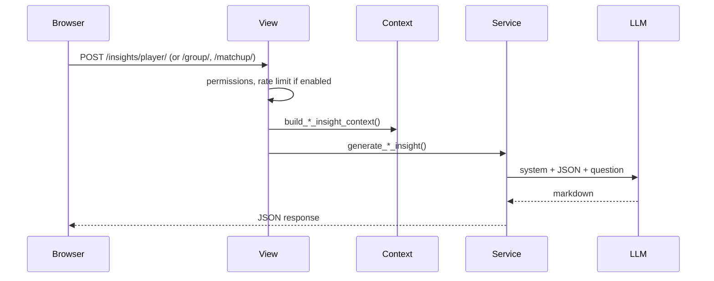
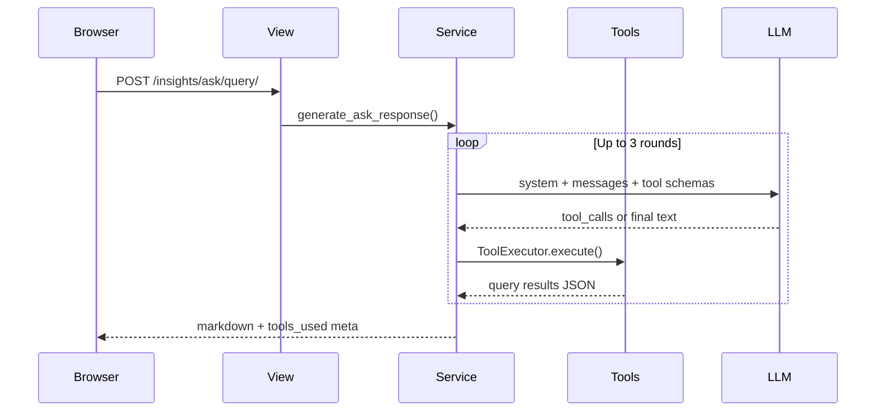

# LeaderLodge AI Insights

> **Companion:** [architecture.md](./architecture.md) (app layout and ranking design)

**Tagline:** *Computed by LeaderLodge. Explained by AI.*

LeaderLodge **computes** rankings in Python. Cloud LLMs **narrate** them in plain language. API keys stay server-side; users pick from three curated cheap models. Every answer is grounded in data LeaderLodge already measured.

---

## Two ways AI is used

### 1. Contextual insights (page-bound)

On rank detail, leaderboard, Hall of Fame, matchup, and game detail pages, an **Insights** offcanvas opens beside the data the user is already viewing.

| Step | What happens |
|------|----------------|
| Context | Python builds a fixed JSON snapshot (`context/player.py`, `context/group.py`, `context/matchup.py`) from ORM queries the page already trusts |
| Question | User picks a **preset** (Strengths, Overview, Dynamics, etc.) or types a short **custom** question about that snapshot |
| LLM | One completion call: system prompt + JSON + question. No tool loop |
| Output | Markdown summary |

The model never chooses what to query. Context scope is locked to the open page (this player, this leaderboard, this game).

### 2. Ask the Lodge (open questions)

`/insights/ask/` accepts free-form natural language scoped to a group and game type.

| Step | What happens |
|------|----------------|
| Question | User types anything ("Who finishes 2nd most in 5-player dominos?") |
| LLM | Proposes **validated tool calls** (`insights/tools/`) |
| Python | `ToolExecutor` runs ORM queries; results return as JSON |
| LLM | Narrates from tool output (up to 3 tool rounds) |
| Output | Markdown answer |

The model cannot run SQL or invent stats. It selects from a fixed tool catalog; Python enforces arguments and permissions. Each Ask request includes a **player roster** (id, display label, username, first name) so questions can use friendly names; `query_player_detail` also accepts `player_query` for server-side name matching.

**Capability audit and expansion plan:** [ask-the-lodge-capabilities.md](./ask-the-lodge-capabilities.md) (supported vs unsupported question types, tool limits, planned expansion).

**Entry points:** Navbar **Ask** (violet `bi-stars`; icon on mobile, icon + label on desktop) and Account menu **Ask the Lodge**.

---

## Shipped surfaces

| Surface | Mode | API | Entry |
|---------|------|-----|-------|
| Rank detail | Contextual | `POST /insights/player/` | Insights button |
| Leaderboard | Contextual | `POST /insights/group/` | Insights button |
| Hall of Fame | Contextual | `POST /insights/group/` | Insights button |
| Matchup | Contextual | `POST /insights/matchup/` | Insights button |
| Game detail | Contextual | `POST /insights/matchup/` | Insights button |
| Ask the Lodge | Tool calling | `POST /insights/ask/query/` | Navbar Ask, Account menu |

### Contextual presets

**Player:** `strengths`, `weaknesses`, `superpower`, `custom`

**Group / leaderboard:** `overview`, `standouts`, `competition`, `custom`

**Hall of Fame:** `overview`, `standouts`, `dynasty`, `custom`

**Matchup / game detail:** `dynamics`, `head_to_head`, `game_impact`, `custom`

### Ask tools

| Tool | Purpose |
|------|---------|
| `list_game_types` | Game types with recorded games in the group |
| `list_group_players` | Active roster with ids and name aliases |
| `query_leaderboard` | Rankings for a game type and optional period/size |
| `query_placement_leaders` | Who finishes in a placement most often (0=1st, 1=2nd, ...) |
| `query_month_leaders` | Leaders for a calendar month |
| `query_rank_trends` | Rank score change between recent and prior windows |
| `query_player_detail` | One player: rank, placements, scores, dates, podium, ties |
| `query_head_to_head` | Two players in games they both attended |
| `query_hall_of_fame` | Period leaders across years or months |

Period-aware tools accept optional `year`, `month`, and `all_time` (ignore Ask page default period). See [ask-the-lodge-capabilities.md](./ask-the-lodge-capabilities.md) for the full capability matrix.

---

## App layout

```
leaderlodge/insights/
  registry.py          # model slugs
  limits.py            # rate limit config (merge defaults, settings, user)
  rate_limit.py        # cache counters (gated by env flag)
  context/             # player, group, matchup JSON builders
  tools/               # Ask tool schemas + executor
  prompts.py           # system prompts, preset templates (PROMPT_VERSION)
  providers/           # OpenAI, Google HTTP clients
  router.py            # complete_insight() and complete_with_tools()
  service.py           # generate_*_insight(), generate_ask_response()
  views.py + urls.py
```

### Contextual request flow



### Ask request flow



### Context builders

**Player** (`build_player_insight_context`): `get_player_rank_detail()`, leader comparison, period label.

**Group** (`build_group_insight_context`): leaderboard snapshot or Hall of Fame grid (`scope`: `leaderboard` | `hall_of_fame`).

**Matchup** (`build_matchup_insight_context`): shared by matchup and game detail. Includes `computed_rankings` (Python-sorted leaders) so the model compares using precomputed order, not raw number inference.

Omit raw game dumps and PII beyond display names. Each payload carries `schema_version`; bump when fields change.

---

## Models

Owner pays. Users pick among three low-cost cloud models:

| Slug | Label | Provider | API model |
|------|-------|----------|-----------|
| `gpt-4o-mini` | GPT-4o mini | OpenAI | `gpt-4o-mini` |
| `gemini-flash` | Gemini Flash | Google | `gemini-2.5-flash` |
| `flash-lite` | Gemini Flash-Lite | Google | `gemini-2.5-flash-lite` |

Default: `gpt-4o-mini`. User preference: `UserProfile.ui_settings['insights']['model_id']`. Registry: `registry.py`.

---

## Prompts and guardrails

- `PROMPT_VERSION = 6` in `prompts.py`; bump when instructions change.
- Contextual prompts: analyst role, JSON-only facts, use `computed_rankings` for comparisons, sparse-data handling, markdown cap.
- Ask prompt: call tools before answering; placement is 0-indexed in tools; no tool names in the final answer.
- Custom questions: length cap, strip control chars.
- UI disclaimer: *AI summary. Rankings computed by LeaderLodge.*

Same permissions as the page (group visibility). Never let the LLM calculate `rank_score` or query the DB except through validated Ask tools.

---

## API contract

All insight endpoints return `{ "markdown": "...", "meta": { "model", "cached", "prompt_version", ... } }`. Errors: 403 permission, 429 rate limit (when enabled), 502 provider error.

**Player** `POST /insights/player/`: `group_id`, `player_id`, `game_type_code`, `year`, `month`, `preset`, `question`, `model`

**Group** `POST /insights/group/`: `group_id`, `scope`, `game_type_code`, period fields, `granularity` (Hall of Fame), `preset`, `question`, `model`, `refresh`

**Matchup** `POST /insights/matchup/`: `game_id`, `preset`, `question`, `model`, `refresh`

**Ask** `POST /insights/ask/query/`: `group_id`, `game_type_code`, `question`, optional `year`/`month`, `model`, `refresh`

---

## Security, rate limits, and env

- Keys in env only: `OPENAI_API_KEY`, `GOOGLE_AI_API_KEY`.
- `INSIGHTS_ENABLED=false` hides the AI feature.
- Display names and aggregates are sent to third-party APIs.

Rate limit code is complete but **off by default** (`INSIGHTS_RATE_LIMITS_ENABLED=false`). Views call `check_insight_rate_limit()` either way; flip the env var to enforce. Redis is only needed when limits are on and multiple workers share counters; LocMem is fine for single-process dev.

| Variable | Purpose |
|----------|---------|
| `INSIGHTS_ENABLED` | Feature kill switch |
| `INSIGHTS_RATE_LIMITS_ENABLED` | Enforce caps |
| `OPENAI_API_KEY` / `GOOGLE_AI_API_KEY` | Providers |
| `INSIGHTS_LIMITS_JSON` | Site-wide cap overrides |
| `REDIS_URL` | Shared cache when limits on + multi-worker |

See `.env.example` and `setup.md` for local and Railway promotion.

---

## Testing

- Context builders: golden JSON fixtures.
- Providers: mock `router.complete_insight()` / `complete_with_tools()` in CI; no live API calls.
- Rate limits: `@override_settings(INSIGHTS_RATE_LIMITS_ENABLED=True)` in enforcement tests.
- Ask tools: executor and placement query tests in `tests/test_insights_tools.py`, `tests/test_insights_ask.py`.

---

## Key files

- Contextual UI: `templates/leaderboards/rank_detail.html`, `leaderboard.html`, `hall_of_fame.html`, `templates/games/matchup.html`, `game_detail.html`
- Ask UI: `templates/insights/ask.html`
- Ranking source: `leaderlodge/leaderboards/service.py`
- UI settings: `leaderlodge/accounts/ui_settings.py`
