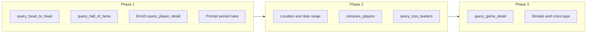

# Ask the Lodge: capability audit and expansion plan

> **Companion:** [ai-insights.md](./ai-insights.md) is the product and engineering spec for what Ask can answer, what it cannot, and how to expand coverage.

---

| Doc                                                              | Role                                                                   |
| ---------------------------------------------------------------- | ---------------------------------------------------------------------- |
| [ai-insights.md](./ai-insights.md)                               | Operational reference: how insights work, API shapes, UX, env, testing |
| [ask-the-lodge-capabilities.md](./ask-the-lodge-capabilities.md) | Planning spec: capability matrix, tool limits, roadmap, open decisions |

`ai-insights.md` already lists the seven Ask tools in a summary table. The audit below goes deeper (example questions, reliability notes, phased API design) and will change as tools ship. Keeping it separate avoids turning the main insights doc into a living backlog.

---

## How Ask works (constraints that affect every answer)

| Constraint      | Value                                                              | Effect                                                                                             |
| --------------- | ------------------------------------------------------------------ | -------------------------------------------------------------------------------------------------- |
| Tool rounds     | Up to 3                                                            | Complex questions that need many sequential lookups may fail with "exceeded the tool call limit"   |
| Row limit       | 1 to 20 per tool (`ToolExecutor.MAX_LIMIT`)                        | "Everyone in the group" questions truncate                                                         |
| Rankings        | Python ORM only                                                    | The model never computes `rank_score`, placement counts, or trends                                 |
| Scope           | One group per request                                              | No cross-group comparisons                                                                         |
| Default period  | Ask page filters (`year` / `month` on `POST /insights/ask/query/`) | When a tool omits `year` and `month`, the UI-selected period applies (not always "all time")       |
| Player roster   | Active players only, embedded in the user message                  | Inactive or historical players may not resolve                                                     |
| Placement index | 0 = 1st, 1 = 2nd, 2 = 3rd in tool args                             | The model must translate "2nd place" to `placement=1`                                              |
| Debug           | `include_debug: true` on any insight POST                          | Returns `tool_rounds`, `available_tools`, full LLM message chain (`leaderlodge/insights/debug.py`) |

---

## Current tool catalog (parameters and behavior)

### `list_game_types`

No parameters. Returns game type codes that have at least one recorded game in the group.

### `list_group_players`

No parameters. Returns active roster: `player_id`, `display_label`, `display_name`, optional `username`, `first_name`, `last_name`.

### `query_leaderboard`

| Parameter        | Required | Notes                                                |
| ---------------- | -------- | ---------------------------------------------------- |
| `game_type_code` | Yes      | Must exist in group                                  |
| `year`, `month`  | No       | Calendar period; omit both to use Ask default period |
| `game_size`      | No       | Filter by player count (2, 3, 4, 5, ...)             |
| `limit`          | No       | Default 10, max 20                                   |

Returns ranked rows: `rank`, `rank_score`, `games_played`, `wins`, `win_pct`.

### `query_placement_leaders`

| Parameter        | Required | Notes                                                      |
| ---------------- | -------- | ---------------------------------------------------------- |
| `game_type_code` | Yes      |                                                            |
| `placement`      | Yes      | 0-indexed: 0 = 1st, 1 = 2nd, ... max 9                     |
| `year`, `month`  | No       | Same period resolution as leaderboard                      |
| `game_size`      | No       | Strongly affects meaning for "2nd place" in N-player games |
| `limit`          | No       | Default 10, max 20                                         |

Returns players ordered by **weighted count** of finishes at that placement (`leaderlodge/insights/tools/placements.py`).

**Important:** This answers "who finishes in this placement most often," not "who had the highest rank score in January." For monthly rank leaders, use `query_month_leaders`.

### `query_month_leaders`

| Parameter        | Required | Notes                                                                                                           |
| ---------------- | -------- | --------------------------------------------------------------------------------------------------------------- |
| `game_type_code` | Yes      |                                                                                                                 |
| `month`          | Yes      | 1 to 12                                                                                                         |
| `year`           | No       | If set: leaders for that calendar month in that year. If omitted: **aggregate the same month across all years** |
| `game_size`      | No       |                                                                                                                 |
| `metric`         | No       | `rank_score` (default), `wins`, or `games_played`                                                               |
| `limit`          | No       | Default 10, max 20                                                                                              |

### `query_rank_trends`

| Parameter        | Required | Notes                                                                                |
| ---------------- | -------- | ------------------------------------------------------------------------------------ |
| `game_type_code` | Yes      |                                                                                      |
| `days`           | No       | 7 to 365, default 90. Recent window = last N days; prior window = N days before that |
| `game_size`      | No       |                                                                                      |
| `limit`          | No       | Sorted by `improvement` (recent minus prior rank score)                              |

**Skips players** with zero weighted games in either window (`leaderlodge/insights/tools/trends.py`).

### `query_player_detail`

| Parameter                     | Required | Notes                                         |
| ----------------------------- | -------- | --------------------------------------------- |
| `game_type_code`              | Yes      |                                               |
| `player_id` or `player_query` | One of   | `player_query` uses server-side name matching |
| `year`, `month`, `game_size`  | No       | Period and field-size filters                 |

Returns a **subset** of `get_player_rank_detail`: rank, rank_score, games_played, wins, win_pct, average_field_size, placement breakdown (`placements[]` with weighted counts and percentages). Does **not** expose best/worst scores, streaks, dates, podium totals, loss breakdown, or vesting details.

---

## Capability matrix

### Supported today (reliable when the model picks the right tool and args)

| Category                      | Example questions                                    | Tool(s)                                                                                           |
| ----------------------------- | ---------------------------------------------------- | ------------------------------------------------------------------------------------------------- |
| Current standings             | "Who leads dominos all time?"                        | `query_leaderboard`                                                                               |
| Period standings              | "Who was on top in 2025?" / "March 2026 leaderboard" | `query_leaderboard` with `year` / `month`                                                         |
| Field-size standings          | "Who leads 5-player dominos?"                        | `query_leaderboard` + `game_size`                                                                 |
| Placement frequency           | "Who finishes 2nd most in dominos?"                  | `query_placement_leaders`, `placement=1`                                                          |
| Placement + period            | "Who got 2nd place most in January 2026?"            | `query_placement_leaders`, `placement=1`, `month=1`, `year=2026`                                  |
| Placement + month (all years) | "Who gets 2nd most every January?"                   | `query_placement_leaders`, `placement=1`, `month=1` (no year)                                     |
| Monthly leaders               | "Who wins most in December?"                         | `query_month_leaders`, `month=12`, `metric=wins`                                                  |
| Monthly rank score            | "Best rank score in June 2025"                       | `query_month_leaders`, `year=2025`, `month=6`                                                     |
| Trends                        | "Who is improving most in the last quarter?"         | `query_rank_trends`, `days=90`                                                                    |
| Player snapshot               | "How is Nancy doing in dominos?"                     | `query_player_detail`, `player_query`                                                             |
| Player placement mix          | "What place does David finish most often?"           | `query_player_detail` (read `placements` in result)                                               |
| Roster discovery              | "Who is in our group?"                               | `list_group_players`                                                                              |
| Game types                    | "What games do we track?"                            | `list_game_types`                                                                                 |
| Two-player career compare     | "How do Nancy and David stack up in dominos?"        | Two `query_player_detail` calls in one round (tested in `tests/test_insights_ask_integration.py`) |

### Partial or unreliable (data may exist in LeaderLodge but Ask often misses or misstates)

| Category                         | Example questions                                                | Why unreliable                                                                                                          |
| -------------------------------- | ---------------------------------------------------------------- | ----------------------------------------------------------------------------------------------------------------------- |
| UI period vs question intent     | User sets Ask filter to "2025" but asks "Who leads all time?"    | Tools without explicit `year`/`month` inherit UI period                                                                 |
| Placement without field size     | "Who finishes last?" in groups that mix 3- and 5-player games    | Last placement index depends on `game_size`; model may omit filter                                                      |
| Head-to-head / rivalry           | "Who wins more when Nancy and David play together?"              | No shared-table tool; two `query_player_detail` calls only compare overall stats, not games both attended               |
| Multi-tool chains                | "Compare dominos and mahjongg leaders, then who improves faster" | May exceed 3 rounds or wrong tool order                                                                                 |
| Inactive players                 | "How did former member Alex do?"                                 | Roster and `resolve_player_query` use active players only                                                               |
| Sparse trends                    | "Who improved most this month?"                                  | `query_rank_trends` needs games in **both** windows; short windows exclude many players                                 |
| Ambiguous names                  | "How is Pat doing?" with two Pats                                | `ToolExecutionError` or wrong player if partial match is unique                                                         |
| "Most" without metric            | "Who is the best in dominos?"                                    | Model must choose rank_score vs wins vs placement; may pick wrong tool                                                  |
| Hall of Fame / dynasty           | "Who dominated across years?" / "Repeat monthly winners?"        | No Hall of Fame grid tool (contextual group insight has this; Ask does not)                                             |
| Last place leader                | "Who loses most?"                                                | Only if game type `supports_loser` and model uses placement or win/loss fields correctly; no dedicated loss-leader tool |
| Exact counts across many players | "Rank everyone by 2nd-place finishes"                            | `limit` caps at 20; model may not paginate                                                                              |

### Not supported today (no tool path; answer would be invented or refused)

| Category                     | Example questions                                   | Gap                                                                         |
| ---------------------------- | --------------------------------------------------- | --------------------------------------------------------------------------- |
| Head-to-head record          | "Nancy vs David: who wins when they share a table?" | Needs `query_head_to_head` (logic exists in `leaderlodge/games/matchup.py`) |
| Specific game                | "What happened in the game on 3/15/2026?"           | No game-level tool; matchup insight is page-bound                           |
| Location stats               | "Who leads at Joe's house?"                         | No `location_id` on any Ask tool                                            |
| Score highlights             | "What was Nancy's best dominos score?"              | `get_player_rank_detail` has it; Ask tool does not surface it               |
| Custom date range            | "Leaders from Spring Break week"                    | Only calendar year/month or fixed-day trend windows                         |
| Streaks                      | "Longest win streak?"                               | Not computed in any Ask tool                                                |
| Rank movement after one game | "Who did Nancy pass when she won last Tuesday?"     | Matchup view only                                                           |
| Cross game type summary      | "Who is best across all our games?"                 | No multi-type aggregate tool                                                |
| Ad-hoc 3+ player set stats   | "Stats when Nancy, David, and Pat play together"    | Head-to-head logic is game-scoped in matchup, not exposed to Ask            |
| Predictions                  | "Who will win next month?"                          | Prompt forbids; no predictive data                                          |

---

## Clarification: the January / 2nd-place example

Prior discussion asked whether "Who got 2nd place most in January?" is possible.

**Backend:** Yes. `query_placement_leaders` accepts `month` (and optional `year`) via the same `LeaderboardPeriod` path as `query_leaderboard`. `filter_results_by_period` filters on `played_on__month` (and `year` when set).

**Reliability bottleneck:** The LLM must call the right tool with `placement=1` and the intended month/year semantics:

- "January 2026" needs `month=1`, `year=2026`.
- "Every January" needs `month=1` with no `year` (not `query_month_leaders`, which ranks by rank score/wins for that month, not placement frequency).

Use debug mode to confirm the model's tool args match the user's intent.

---

## Proposed new tools

### Phase 1: Quick wins (reuse existing services, small schema additions)

| Tool                         | Arguments                                                                                      | Unlocks                                                      | Implementation notes                                                                                                                                      |
| ---------------------------- | ---------------------------------------------------------------------------------------------- | ------------------------------------------------------------ | --------------------------------------------------------------------------------------------------------------------------------------------------------- |
| `query_head_to_head`         | `game_type_code`, `player_a` / `player_b` (id or query), optional `year`, `month`, `game_size` | Shared-table wins, games together, ties                      | Wrap `_head_to_head_stats` / `build_game_list_stats` on games where both players participated                                                             |
| `query_hall_of_fame`         | optional `granularity` (`year` / `month`), optional `game_type_code`, `limit`                  | Dynasty, repeat period winners, "who won 2024 in each game?" | Wrap `build_hall_of_fame_grid` from `leaderlodge/leaderboards/hall_of_fame.py`                                                                            |
| Enrich `query_player_detail` | (same entry point)                                                                             | Best/worst score, date range, podium count/pct, tie count    | Add optional `fields` enum or always include a few high-value columns from `PlayerRankDetail`                                                             |
| Prompt + schema tweak        | N/A                                                                                            | Period disambiguation                                        | System prompt: when the question says "all time," pass no year/month even if UI filter is set; mention `query_placement_leaders` vs `query_month_leaders` |

**Optional HTTP (not required for Ask):** None in Phase 1. Ask tools are enough if the executor wraps existing Python.

### Phase 2: Medium scope (new query shapes)

| Tool                           | Arguments                                                            | Unlocks                                                           | Implementation notes                                                 |
| ------------------------------ | -------------------------------------------------------------------- | ----------------------------------------------------------------- | -------------------------------------------------------------------- |
| `query_placement_summary`      | `game_type_code`, optional period, `game_size`, `player_query`       | Full placement histogram for one player without rank detail noise | Thin wrapper over placement aggregation                              |
| `query_loss_leaders`           | `game_type_code`, optional period, `game_size`, `limit`              | "Who loses most?" for progressive rummy-style games               | Filter `supports_loser`; aggregate LOSS results or last placement    |
| `query_date_range_leaderboard` | `game_type_code`, `start_date`, `end_date`, optional `game_size`     | Spring break, custom weeks                                        | `filter_results_by_period` extension or played_on range filter       |
| `query_location_leaderboard`   | `game_type_code`, `location_query` or `location_id`, optional period | Venue-specific leaders                                            | Mirror leaderboard service `location_id` param                       |
| `compare_players`              | `game_type_code`, `player_queries[]` (2 to 5), optional period       | Side-by-side table in one tool round                              | Single JSON payload; saves a tool round vs N x `query_player_detail` |

**HTTP endpoints (if needed outside Ask):**

| Endpoint                             | Purpose                                                                              |
| ------------------------------------ | ------------------------------------------------------------------------------------ |
| `GET /api/groups/{id}/head-to-head/` | Matchup page picker (`TODO.md` ad-hoc comparison); same core as `query_head_to_head` |
| `GET /api/groups/{id}/hall-of-fame/` | JSON grid for marketing demo or embed                                                |

### Phase 3: Larger work

| Item                                                         | Unlocks                               | Notes                                                                    |
| ------------------------------------------------------------ | ------------------------------------- | ------------------------------------------------------------------------ |
| `query_game_detail`                                          | "Tell me about the game on ..."       | Needs game lookup by date + disambiguation; returns slim matchup context |
| `query_streaks`                                              | Win/loss/podium streaks               | New aggregation in leaderboards or games layer                           |
| `query_multi_game_type`                                      | Cross-game-type player summary        | Wrap `get_player_stats`                                                  |
| Raise or configurable tool round limit                       | Deep multi-step questions             | Trade latency/cost; consider 4 to 5 rounds only for Ask                  |
| Inactive player support in `list_group_players` / resolution | Alumni questions                      | Product decision on privacy and roster size                              |
| Suggested questions UI                                       | Guide users toward supported patterns | Frontend only; driven by this matrix                                     |

---

## Phased roadmap summary

| Phase | Effort          | User-visible impact                                                         |
| ----- | --------------- | --------------------------------------------------------------------------- |
| 1     | Small to medium | Rivalry questions, dynasty/Hall of Fame, richer player answers              |
| 2     | Medium          | Venue and custom periods, clearer loss leaders, faster multi-player compare |
| 3     | Large           | Game-specific stories, streaks, cross-game-type "best overall"              |

---

## Open questions (for product decision)

1. **UI period vs tool period:** Should Ask ignore UI year/month when the question explicitly says "all time"? Today tools inherit scope period when args are omitted.
2. **Debug visibility:** `insights_debug_allowed` returns `True` for all users. Keep open for portfolio demos or restrict to staff?
3. **Head-to-head scope:** Same game type only, or any shared game? Matchup code today is per `game_type_code`.
4. **Inactive players:** Include in roster for Ask name resolution?
5. **Tool round limit:** Stay at 3 or bump when Phase 1 adds more tools (more temptation to chain)?
6. **Landing demo:** Live Ask vs canned answers (`TODO.md` AI showcase items): which questions should be guaranteed supported?
7. **HTTP vs Ask-only:** Is ad-hoc matchup (`TODO.md`) a separate page that shares executor code, or strictly an Ask tool?

---

## Validation checklist (debug mode)

When testing a question manually:

1. POST `/insights/ask/query/` with `include_debug: true` and `refresh: true`.
2. Inspect `debug.tool_rounds`: tool names, arguments, raw JSON results.
3. Confirm period args match the question (not just the UI filter).
4. For placement questions, confirm `placement` is 0-indexed and `game_size` if relevant.
5. Compare tool output to leaderboard/Hall of Fame pages for the same group and filters.

---

## Key source files

| Area                            | Path                                                                                                                                               |
| ------------------------------- | -------------------------------------------------------------------------------------------------------------------------------------------------- |
| Tool schemas                    | `leaderlodge/insights/tools/schemas.py`                                                                                                            |
| Executor                        | `leaderlodge/insights/tools/executor.py`                                                                                                           |
| Placements                      | `leaderlodge/insights/tools/placements.py`                                                                                                         |
| Trends / month leaders          | `leaderlodge/insights/tools/trends.py`                                                                                                             |
| Standings / player detail       | `leaderlodge/insights/tools/standings.py`                                                                                                          |
| Player resolution               | `leaderlodge/insights/tools/players.py`                                                                                                            |
| Ask orchestration               | `leaderlodge/insights/service.py`                                                                                                                  |
| System prompt                   | `leaderlodge/insights/prompts.py` (`ASK_SYSTEM_PROMPT`)                                                                                            |
| HTTP                            | `leaderlodge/insights/views.py` (`ask_query`)                                                                                                      |
| Ranking source                  | `leaderlodge/leaderboards/service.py`                                                                                                              |
| Head-to-head (not wired to Ask) | `leaderlodge/games/matchup.py`                                                                                                                     |
| Tests                           | `tests/test_insights_tools.py`, `tests/test_insights_ask.py`, `tests/test_insights_ask_integration.py`, `tests/test_insights_player_resolution.py` |
